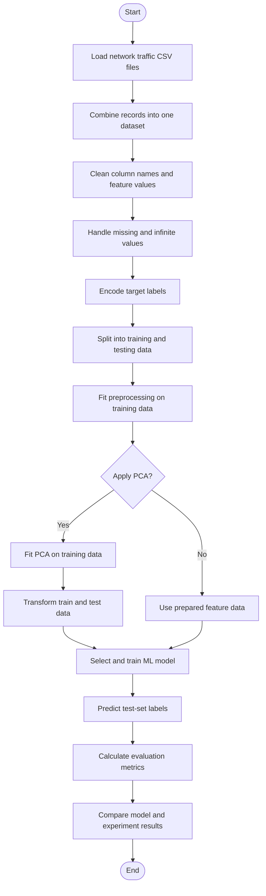

# Network Intrusion Detection Using Machine Learning

A Semester 3 machine-learning coursework project that studies network traffic and classifies it into benign or attack-related categories. The repository explores four machine-learning approaches and compares model performance under different train-test splits and PCA dimensionality-reduction settings.

> **Project status:** Academic prototype. Results depend on the dataset files, preprocessing, model configuration, and experiment scripts. This project is not a production network-security system.

## Table of Contents

- [Overview](#overview)
- [Problem Statement](#problem-statement)
- [Objectives](#objectives)
- [Proposed Work](#proposed-work)
- [Repository Structure](#repository-structure)
- [Dataset](#dataset)
- [Technology Stack](#technology-stack)
- [Methodology](#methodology)
- [System Flowchart](#system-flowchart)
- [Experimental Design](#experimental-design)
- [Evaluation Metrics](#evaluation-metrics)
- [Installation and Execution](#installation-and-execution)
- [Results and Output](#results-and-output)
- [Limitations and Implementation Notes](#limitations-and-implementation-notes)
- [Future Scope](#future-scope)
- [Contributors](#contributors)
- [Disclaimer](#disclaimer)

## Overview

Network traffic contains patterns that can help distinguish ordinary communication from suspicious or malicious activity. Manually reviewing large volumes of traffic is difficult, so machine-learning methods can be investigated as a way to learn patterns from labelled network-flow records.

This project uses network traffic data collected across multiple days, preprocesses the records, trains classification models, and evaluates their predictions using standard classification metrics. Principal Component Analysis (PCA) is also investigated to reduce the number of input dimensions and study its effect on model performance.

## Problem Statement

Given labelled network-flow data containing numerical traffic features, develop and evaluate machine-learning models that can classify traffic into its corresponding class. Compare multiple algorithms and experimental configurations to understand their predictive performance and the trade-off between dimensionality and classification quality.

## Objectives

1. Load and combine network traffic records from multiple dataset files.
2. Clean feature names and convert feature columns into numeric form.
3. Handle missing and infinite feature values.
4. Encode target labels for model training.
5. Train and compare Logistic Regression, Elastic Net, CatBoost, and k-Nearest Neighbors (KNN).
6. Study the effect of different train-test split ratios.
7. Investigate PCA with different component counts.
8. Evaluate models using accuracy, precision, recall, F1-score, and a confusion matrix.
9. Identify suitable model and preprocessing configurations for the given dataset.

## Proposed Work

The proposed workflow is to create a repeatable machine-learning pipeline for network traffic classification:

- **Data integration:** combine the selected traffic CSV files into one dataset.
- **Data preparation:** clean column names, convert feature values to numeric, and treat missing or infinite values.
- **Feature reduction:** optionally apply PCA using components fitted only on the training data.
- **Model training:** train the selected algorithms using the same data split for a fair comparison.
- **Testing:** predict labels for unseen test records.
- **Evaluation:** calculate classification metrics and compare configurations.
- **Analysis:** review class-wise performance and identify where models misclassify traffic.

The intended outcome is a comparative study rather than a claim that one model is universally best.

## Repository Structure

```text
Python-Project/
├── CatBoost/                  # CatBoost experiment scripts
├── Elastic Net/               # Elastic Net experiment scripts
├── LogisticRegression/         # Logistic Regression experiment scripts
├── kNeighbourClassifier/       # KNN experiment scripts
├── index.py                   # Main/root experiment script
├── Outputs_Sheets.pdf          # Collected output sheets (if included in checkout)
├── README.md                  # Project documentation
└── .gitignore
```

The repository also expects the network-traffic CSV files listed in the [Dataset](#dataset) section. They may need to be obtained separately and placed in the working directory. Folder contents and experiment scripts may vary as the project evolves.

## Dataset

The root script reads the following CSV files:

- `Tuesday-workingHours.pcap_ISCX.csv`
- `Wednesday-workingHours.pcap_ISCX.csv`
- `Thursday-WorkingHours-Morning-WebAttacks.pcap_ISCX.csv`

These filenames correspond to network-flow data in the CIC-IDS2017-style dataset. Keep the filenames unchanged or update the paths in the script accordingly.

The script treats all columns except the last as input features (`X`) and the final column as the target label (`y`). Therefore, verify that the target label is actually the last column in each file before running the project.

## Technology Stack

| Technology | Purpose |
|---|---|
| Python | Project implementation |
| NumPy | Numerical operations |
| Pandas | CSV loading, data cleaning, and concatenation |
| Scikit-learn | Preprocessing, train-test split, PCA, models, and metrics |
| CatBoost | Gradient-boosting classifier experiment |
| Matplotlib / Seaborn | Data visualization, where used by experiment scripts |

## Methodology

### 1. Data collection and loading

Load the selected CSV files and combine them row-wise into a single dataset. A consistent set of feature columns is required across the files.

### 2. Data cleaning

- Remove leading and trailing whitespace from column names.
- Convert feature columns to numeric values; values that cannot be converted become missing values.
- Replace positive and negative infinity with missing values.
- Impute missing feature values. The root script currently uses mean imputation.

### 3. Target preparation

Encode the categorical target labels into integer class IDs. Keep the label encoder so that predicted class IDs can later be mapped back to their original class names.

### 4. Train-test split

Split the dataset into training and testing subsets. The root script currently uses a 20% test set, a fixed random seed, and stratification by class to preserve class proportions.

### 5. Feature scaling and PCA

For algorithms sensitive to feature scale and for PCA, scale numeric features using a scaler fitted on the training set only. Apply PCA by fitting it on training data and transforming both training and test data with the same fitted PCA object.

The root script currently applies PCA with 5 components. Other experiment configurations investigate 10 and 15 components.

### 6. Model training

Train the selected algorithm on the transformed training data. For a fair comparison, use the same split and preprocessing pipeline across models whenever possible.

### 7. Prediction and evaluation

Generate predictions for the test set and calculate accuracy, weighted precision, weighted recall, weighted F1-score, a confusion matrix, and a class-wise classification report.

### 8. Comparison

Compare models across the selected split ratios and PCA component counts. Report both aggregate metrics and class-wise results, particularly when the dataset is imbalanced.

## System Flowchart



## Experimental Design

The project description specifies the following comparison settings:

| Parameter | Values |
|---|---|
| Algorithms | Logistic Regression, Elastic Net, CatBoost, KNN |
| Test size | 0.2, 0.4, 0.6 |
| PCA components | 5, 10, 15 |

This produces a planned grid of model and configuration comparisons. Not every combination is necessarily implemented in the root script; check the individual experiment folders and output sheets for the runs actually completed.

## Evaluation Metrics

- **Accuracy:** proportion of all test records classified correctly.
- **Precision:** proportion of predicted records for a class that belong to that class.
- **Recall:** proportion of actual records of a class that the model correctly identifies.
- **F1-score:** harmonic mean of precision and recall.
- **Confusion matrix:** shows correct and incorrect predictions by class.
- **Classification report:** provides class-wise precision, recall, F1-score, and support.

For network intrusion detection, accuracy alone can be misleading when benign and attack classes are imbalanced. Weighted and per-class metrics should therefore be reported together.

## Installation and Execution

### Prerequisites

- Python 3.9 or later recommended
- The required dataset CSV files
- Git

### 1. Clone the repository

```bash
git clone https://github.com/Inf3rno26/Python-Project.git
cd Python-Project
```

### 2. Create and activate a virtual environment

```bash
python -m venv .venv
```

**Windows**

```bash
.venv\Scripts\activate
```

**macOS / Linux**

```bash
source .venv/bin/activate
```

### 3. Install dependencies

```bash
pip install numpy pandas scikit-learn matplotlib seaborn catboost
```

### 4. Add the dataset

Place the three CSV files listed under [Dataset](#dataset) in the repository root, alongside `index.py`.

### 5. Run the root script

```bash
python index.py
```

The root script currently runs an Elastic Net experiment with a 20% test split and 5 PCA components, then prints the confusion matrix and classification metrics. Run the scripts inside the algorithm-specific folders to execute their respective experiments.

## Results and Output

The scripts report classification metrics in the terminal. The repository also includes `Outputs_Sheets.pdf`, which may contain collected experiment outputs.

When documenting final results, use a table such as the following and fill it with values from actual runs:

| Model | Test size | PCA components | Accuracy | Weighted precision | Weighted recall | Weighted F1 |
|---|---:|---:|---:|---:|---:|---:|
| Logistic Regression | — | — | — | — | — | — |
| Elastic Net | — | — | — | — | — | — |
| CatBoost | — | — | — | — | — | — |
| KNN | — | — | — | — | — | — |

Do not enter estimated or invented scores. Include the dataset version, random seed, and class-wise report alongside the final comparison.

## Limitations and Implementation Notes

The following points are important when interpreting or extending the current code:

1. **Preprocessing leakage:** the root script fits mean imputation before splitting the data. For a leakage-free evaluation, split first and fit the imputer only on training data, then transform the test data.
2. **Scaling:** PCA and distance-based methods such as KNN generally benefit from feature scaling. Use a `StandardScaler` or another suitable scaler inside a pipeline, fitted on training data only.
3. **Elastic Net is a regressor:** the root script uses `ElasticNet` and rounds its continuous output into class IDs. This is a regression-based workaround, not a standard multiclass classifier. Consider `LogisticRegression` with an Elastic Net penalty or another classifier for a more appropriate classification comparison.
4. **Hard-coded class range:** predictions are clipped to class IDs 0 through 2. This assumes exactly three encoded classes and may silently mishandle datasets with a different number of labels. Derive the class count from the label encoder instead.
5. **Target column assumption:** the code assumes the last column is the label. Explicitly select the target column by name to avoid accidentally using the wrong column.
6. **PCA configuration:** PCA requires the number of components to be valid for the feature matrix. Confirm that each requested component count is supported.
7. **Reproducibility:** use consistent random seeds and save each experiment's parameters and metrics.
8. **Data availability:** the CSV files may not be included in the repository due to their size or distribution requirements.

## Future Scope

- Build a reusable Scikit-learn `Pipeline` to prevent preprocessing leakage.
- Add feature scaling and compare results with and without PCA.
- Use suitable classification estimators for every model comparison.
- Evaluate per-class and macro-averaged metrics, especially for minority attack classes.
- Add cross-validation and repeated experiments for more robust results.
- Tune hyperparameters systematically and record the selected configuration.
- Generate visualizations such as confusion-matrix heatmaps and model-comparison charts.
- Export predictions and experiment summaries to CSV.
- Add a simple dashboard for exploring traffic classifications and model results.
- Test the trained model on a separate dataset or later time period to assess generalization.

## Contributors

- [Vishad Jain](https://github.com/Inf3rno26)
- [Mihir Saurabh](https://github.com/Mihir2907)

## Disclaimer

This repository is an educational machine-learning project. It is intended for learning, experimentation, and academic evaluation. Its predictions should not be treated as a substitute for professional network-security monitoring or incident response.
